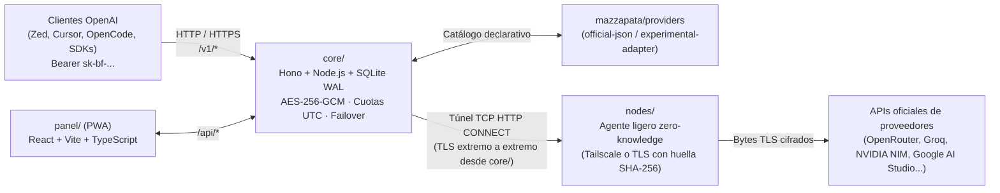

# Bifrost

**Gateway y enrutador *self-hosted* de cuotas gratuitas de modelos de lenguaje con API compatible con OpenAI.**

Bifrost unifica las cuotas gratuitas de múltiples proveedores y cuentas detrás de un único punto de entrada (`/v1/chat/completions` y `/v1/models`), cifra todas las credenciales en reposo con `AES-256-GCM`, reparte cada clave por un nodo de salida dedicado de cero conocimiento y ofrece un panel web progresivo (PWA) con telemetría local, cuotas diarias en UTC para invitados y respaldos cifrados portables.

La aplicación se instala **vacía por diseño**: no incluye claves, cuentas ni proveedores preinstalados. Cada administrador instala bajo demanda únicamente las integraciones que necesita desde el catálogo declarativo [`mazzapata/providers`](https://github.com/mazzapata/providers).

---

## Tabla de contenidos

1. [Arquitectura resumida](#arquitectura-resumida)
2. [Despliegue rápido](#despliegue-rápido)
   - [Opción 1: Docker Compose (recomendada)](#opción-1-docker-compose-recomendada)
   - [Opción 2: Instalación nativa en Linux (`systemd`)](#opción-2-instalación-nativa-en-linux-systemd)
   - [Variables de entorno](#variables-de-entorno)
3. [Conectar clientes compatibles con OpenAI (`sk-bf-...`)](#conectar-clientes-compatibles-con-openai-sk-bf-)
   - [cURL (`/v1/models` y `/v1/chat/completions`)](#curl-v1models-y-v1chatcompletions)
   - [Zed](#zed)
   - [Cursor](#cursor)
   - [OpenCode](#opencode)
   - [SDK oficial de OpenAI (Node.js y Python)](#sdk-oficial-de-openai-nodejs-y-python)
4. [Operación y administración](#operación-y-administración)
   - [Nodos ligeros de salida (`Tailscale` o `IP pública con TLS`)](#nodos-ligeros-de-salida-tailscale-o-ip-pública-con-tls)
   - [Usuarios invitados y cuotas en UTC](#usuarios-invitados-y-cuotas-en-utc)
   - [Respaldos cifrados portables (`.bifrost.enc`)](#respaldos-cifrados-portables-bifrostenc)
5. [Atribución de datos, catálogos y benchmarks](#atribución-de-datos-catálogos-y-benchmarks)
6. [Documentación técnica](#documentación-técnica)
7. [Licencia](#licencia)

---

## Arquitectura resumida



- **[`core/`](core/) — Núcleo y enrutador HTTP:** servidor en TypeScript sobre **Hono** y **Node.js** (≥ 22 LTS) con base de datos **SQLite** en modo `WAL`. Expone la API compatible con OpenAI (`/v1/*`), la API interna del panel (`/api/*`) y sirve los archivos compilados del panel en un único proceso y puerto (`8080` por defecto). Gestiona rotación y *failover* automático entre claves ante límites `429` o fallos de red, reanudación transparente de respuestas SSE cortadas a mitad de generación, sincronización automática de modelos cada 6 horas (`modelsSource: "api"`) y cálculo local de métricas (percentiles `P50`–`P99` de TTFT y `tok/s`, volumen de tokens `prompt`/`completion`/`reasoning` y *uptime* de 60 días calculado sobre peticiones reales sin *pings* sintéticos).
- **[`panel/`](panel/) — Panel web progresivo (PWA):** interfaz en React + Vite + TypeScript instalable en escritorio y móvil (`manifest.webmanifest` + *Service Worker*). Incluye asistente de puesta en marcha, resumen diario de cuotas, gestión de proveedores y múltiples claves cifradas, catálogo enriquecido con comparativas, *Playground* interactivo con medición en vivo de `TTFT` y `tok/s`, visor de registros con redacción automática de secretos y gestión de respaldos.
- **[`nodes/`](nodes/) — Nodos de salida de cero conocimiento (*zero-knowledge*):** agente independiente para máquinas virtuales remotas que opera exclusivamente como túnel TCP transparente mediante `HTTP CONNECT`. El núcleo establece la sesión TLS de extremo a extremo directamente contra el proveedor de destino; el nodo jamás recibe claves API, cabeceras HTTP ni el contenido de los *prompts* o respuestas. Emplea tokens autenticados con rotación automática cada 24 horas (ventana de gracia de 5 minutos) y *heartbeat* cada 30 segundos.
- **[`mazzapata/providers`](https://github.com/mazzapata/providers) — Catálogo de proveedores:** repositorio comunitario curado donde cada proveedor se describe como datos declarativos validados contra [`schemas/provider.schema.json`](schemas/provider.schema.json):
  - `official-json`: fichas JSON puras para APIs oficiales compatibles con OpenAI (cero código ejecutable).
  - `experimental-adapter`: adaptadores aislados en un proceso o contenedor externo (*sidecar*) que exponen un endpoint local compatible con OpenAI.

| Directorio | Propósito |
|---|---|
| [`core/`](core/) | Servidor HTTP (Hono + Node.js), enrutador `/v1/*`, API `/api/*`, criptografía y SQLite (`WAL`). |
| [`panel/`](panel/) | Aplicación web progresiva (React + Vite + TypeScript) para administradores e invitados. |
| [`nodes/`](nodes/) | Agente ligero de salida (`HTTP CONNECT`), instalador `install-node.sh` y unidad `bifrost-node.service`. |
| [`schemas/`](schemas/) | Esquemas JSON oficiales para fichas de proveedores y catálogo de modelos. |
| [`scripts/`](scripts/) | Instalador nativo Linux (`install.sh`), unidad `bifrost.service` y validador de esquemas. |
| [`docs/`](docs/) | Visión del proyecto, registro de decisiones, arquitectura detallada y protocolo núcleo–nodo. |
| [`tests/`](tests/) | Batería automatizada de pruebas de integración, seguridad, enrutamiento y respaldos. |

---

## Despliegue rápido

### Opción 1: Docker Compose (recomendada)

Requisitos: **Docker Engine** y **Docker Compose v2**.

```bash
git clone https://github.com/sxamx/bifrost.git
cd bifrost
docker compose up -d
```

1. En el primer arranque sobre un volumen vacío (`bifrost_data` montado en `/data` con permisos `0700`), el contenedor genera automáticamente una llave maestra aleatoria de 32 bytes en `/data/master.key` con permisos `0600`.
2. Si `/data/bifrost.db` ya existe, Bifrost **nunca** regenera ni sobrescribe `master.key`; si la llave maestra falta o es inválida, aborta el arranque de forma segura para proteger los datos cifrados existentes.
3. Comprueba el estado del servicio y abre el panel web para completar el asistente inicial de creación del administrador:

```bash
curl -fsS http://localhost:8080/api/health
# {"ok":true}
```

Panel web y API disponibles en `http://localhost:8080` (puedes cambiar el puerto publicado en el host con `BIFROST_PORT=9090 docker compose up -d`).

### Opción 2: Instalación nativa en Linux (`systemd`)

Requisitos: distribución **Linux con `systemd`**, **Node.js ≥ 22 LTS** y `npm`.

```bash
git clone https://github.com/sxamx/bifrost.git
cd bifrost
sudo bash scripts/install.sh
```

El instalador realiza de forma idempotente los siguientes pasos:

1. Crea el usuario y grupo de sistema sin shell `bifrost:bifrost`.
2. Prepara `/opt/bifrost` (`0755`, montado en solo lectura por el servicio) y el directorio de datos `/var/lib/bifrost` con permisos estrictos `0700`.
3. Crea `/var/lib/bifrost/master.key` (32 bytes aleatorios, permisos `0600`) únicamente en instalaciones limpias, conservándola intacta en actualizaciones y abortando sin sobrescribir si detecta `bifrost.db` sin `master.key`.
4. Copia el código fuente (incluido `nodes/install-node.sh` para servir `GET /install-node.sh` al vincular nodos), compila `panel/` y `core/`, elimina dependencias de desarrollo y registra `/etc/systemd/system/bifrost.service` con endurecimiento de `systemd` (`ProtectSystem=strict`, `NoNewPrivileges=true`, `PrivateTmp=true`, `UMask=0077`) y autoarranque tras reinicios.

Comandos habituales de mantenimiento:

```bash
sudo systemctl status bifrost
sudo journalctl -u bifrost -f
```

### Variables de entorno

En Docker Compose pueden definirse en un archivo `.env` junto a `docker-compose.yml`; en instalaciones con `systemd`, en `/etc/default/bifrost` (permisos `0600`):

| Variable | Valor por defecto | Descripción |
|---|---|---|
| `PORT` | `8080` | Puerto TCP interno donde escucha el núcleo HTTP (`core/`). |
| `BIFROST_PORT` | `8080` | Puerto publicado en el host al usar `docker-compose.yml`. |
| `DATA_DIR` | `/data` (Docker) / `/var/lib/bifrost` (`systemd`) | Directorio persistente (`0700`) para `bifrost.db` y `master.key`. |
| `BIFROST_MASTER_KEY` | *(vacío; usa `master.key`)* | Llave maestra opcional de 32 bytes codificada en hexadecimal (64 caracteres) o Base64. |
| `BIFROST_MARKETPLACE_URL` | Índice oficial `mazzapata/providers` | URL del índice JSON del catálogo de proveedores. |
| `PANEL_DIST_DIR` | `/app/panel/dist` / `/opt/bifrost/panel/dist` | Ruta a los archivos estáticos compilados del panel web. |

---

## Conectar clientes compatibles con OpenAI (`sk-bf-...`)

1. Entra al panel web, instala al menos un proveedor desde **Marketplace**, añade una o más claves del proveedor y detecta sus modelos.
2. Ve a **API Keys** y genera una llave interna. Bifrost mostrará una sola vez una credencial con formato `sk-bf-...` (en SQLite únicamente se almacena su prefijo y su hash `SHA-256`).
3. En cualquier herramienta o SDK compatible con OpenAI, configura:
   - **Base URL:** `http://localhost:8080/v1` (o `https://tu-dominio-bifrost.ejemplo.com/v1` tras tu proxy TLS).
   - **API Key:** `sk-bf-...`
   - **Model ID:** `<proveedor>/<modelo>` devuelto por `GET /v1/models` (por ejemplo, `openrouter/deepseek/deepseek-chat-v3-0324:free` o `groq/llama-3.3-70b-versatile`).

### cURL (`/v1/models` y `/v1/chat/completions`)

```bash
# Listar los modelos activos autorizados para esta llave
curl -fsS http://localhost:8080/v1/models \
  -H "Authorization: Bearer sk-bf-TU_LLAVE"

# Generar una respuesta (soporta stream: false y stream: true por SSE)
curl -fsS http://localhost:8080/v1/chat/completions \
  -H "Authorization: Bearer sk-bf-TU_LLAVE" \
  -H "Content-Type: application/json" \
  -d '{
    "model": "openrouter/deepseek/deepseek-chat-v3-0324:free",
    "stream": true,
    "messages": [
      { "role": "user", "content": "Explica en tres puntos cómo funciona un túnel HTTP CONNECT." }
    ]
  }'
```

### Zed

Añade Bifrost como proveedor compatible con OpenAI en `~/.config/zed/settings.json` y exporta tu llave en `BIFROST_API_KEY` (o introdúcela desde el panel de agentes de Zed):

```json
{
  "language_models": {
    "openai_compatible": {
      "Bifrost": {
        "api_url": "http://localhost:8080/v1",
        "available_models": [
          {
            "name": "openrouter/deepseek/deepseek-chat-v3-0324:free",
            "display_name": "DeepSeek V3 (Bifrost)",
            "max_tokens": 131072,
            "max_output_tokens": 8192,
            "capabilities": {
              "tools": true,
              "images": false,
              "parallel_tool_calls": true,
              "prompt_cache_key": false
            }
          }
        ]
      }
    }
  }
}
```

### Cursor

1. Abre **Cursor Settings → Models**.
2. En **OpenAI API Key**, pega tu llave `sk-bf-...`.
3. Activa **Override OpenAI Base URL** e introduce la URL pública HTTPS de tu instancia terminada en `/v1` (por ejemplo, `https://bifrost.tu-dominio.com/v1`, ya que los servidores de Cursor realizan las peticiones hacia endpoints accesibles por HTTPS).
4. En la lista de modelos, pulsa **+ Add Model** y añade los identificadores exactos mostrados en `GET /v1/models` (`<proveedor>/<modelo>`).

### OpenCode

En tu archivo `opencode.json` (global en `~/.config/opencode/opencode.json` o en la raíz de tu proyecto), registra Bifrost mediante `@ai-sdk/openai-compatible`:

```json
{
  "$schema": "https://opencode.ai/config.json",
  "provider": {
    "bifrost": {
      "npm": "@ai-sdk/openai-compatible",
      "name": "Bifrost",
      "options": {
        "baseURL": "http://localhost:8080/v1",
        "apiKey": "{env:BIFROST_API_KEY}"
      },
      "models": {
        "openrouter/deepseek/deepseek-chat-v3-0324:free": {
          "name": "DeepSeek V3 (Bifrost)"
        }
      }
    }
  }
}
```

### SDK oficial de OpenAI (Node.js y Python)

**TypeScript / Node.js (`npm install openai`):**

```ts
import OpenAI from 'openai';

const client = new OpenAI({
  apiKey: process.env.BIFROST_API_KEY, // sk-bf-...
  baseURL: 'http://localhost:8080/v1',
});

const models = await client.models.list();
console.log(models.data.map((m) => m.id));

const completion = await client.chat.completions.create({
  model: 'openrouter/deepseek/deepseek-chat-v3-0324:free',
  messages: [{ role: 'user', content: 'Hola desde el SDK oficial de OpenAI.' }],
});
console.log(completion.choices[0]?.message.content);
```

**Python (`pip install openai`):**

```python
import os
from openai import OpenAI

client = OpenAI(
    api_key=os.environ["BIFROST_API_KEY"],  # sk-bf-...
    base_url="http://localhost:8080/v1",
)

stream = client.chat.completions.create(
    model="openrouter/deepseek/deepseek-chat-v3-0324:free",
    messages=[{"role": "user", "content": "Resume qué aporta SQLite en modo WAL."}],
    stream=True,
)

for chunk in stream:
    delta = chunk.choices[0].delta.content
    if delta:
        print(delta, end="", flush=True)
```

---

## Operación y administración

### Nodos ligeros de salida (`Tailscale` o `IP pública con TLS`)

Para evitar que varias cuentas gratuitas de un mismo proveedor compartan la misma IP de salida, Bifrost asigna automáticamente cada nueva clave al nodo activo con menor carga para ese proveedor (y solicita confirmación explícita si el administrador fuerza dos claves del mismo proveedor sobre el mismo nodo).

Desde **Nodos → Añadir nodo** en el panel de administración, elige el modo de transporte y ejecuta en la máquina remota Linux (con `systemd` y Node.js ≥ 22 LTS) el comando generado de un solo uso:

#### 1. Modo `tailscale` (recomendado)

El agente `bifrost-node` se enlaza exclusivamente a la interfaz privada WireGuard de Tailscale (`100.x.y.z`, puerto `9443` por defecto) sin exponer puertos a Internet:

```bash
curl -fsSL https://tu-bifrost.ejemplo.com/install-node.sh \
  | sudo bash -s -- --mode tailscale --port 9443 --token "<TOKEN_INICIAL_DEL_NODO>"
```

#### 2. Modo `public_ip` (IP pública con TLS)

Cuando no se utiliza Tailscale, el nodo levanta un servidor `TLS 1.2+` (generando automáticamente un certificado ECDSA P-256 en `/var/lib/bifrost-node/` o usando certificados propios mediante `--tls-cert` y `--tls-key`) e imprime su huella `SHA-256` para fijarla (*certificate pinning*) en el panel de Bifrost:

```bash
curl -fsSL https://tu-bifrost.ejemplo.com/install-node.sh \
  | sudo bash -s -- --mode public_ip --port 9443 --token "<TOKEN_INICIAL_DEL_NODO>"
```

> **Recomendación de red en modo `public_ip`:** restringe siempre el firewall de la máquina remota (`ufw`, `nftables` o grupo de seguridad del proveedor cloud) para aceptar conexiones al puerto `9443/tcp` únicamente desde la dirección IP del servidor principal de Bifrost.

En ambos modos:
- El instalador guarda en disco únicamente el hash `SHA-256` del token (`/var/lib/bifrost-node/token-state.json` con permisos `0600`) para no exponer secretos en argumentos de procesos.
- Bifrost verifica la salud del nodo cada **30 segundos** (`GET /_bifrost/health`); si supera **120 segundos** sin respuesta, marca temporalmente el nodo como `unresponsive` y pone sus claves en pausa (`no_node`) hasta que se recupere.
- Cada **24 horas**, el núcleo rota automáticamente el token del nodo con una ventana de convivencia de **5 minutos** para no interrumpir túneles activos.

### Usuarios invitados y cuotas en UTC

Bifrost permite compartir capacidad con colaboradores o equipos pequeños sin revelar claves reales de ningún proveedor:

1. **Invitaciones de un solo uso:** desde **Usuarios → Nueva invitación**, el administrador define los modelos permitidos (lista explícita de `<proveedor>/<modelo>` o `*`), el límite diario de tokens y la vigencia del enlace. El invitado se registra eligiendo solo nombre de usuario y contraseña (almacenada con `scrypt`, sin requerir correo electrónico).
2. **Control estricto en servidor (UTC):** el cómputo de cuota (`prompt_tokens + completion_tokens + reasoning_tokens`) utiliza exclusivamente el reloj UTC del servidor en SQLite, ignorando cualquier cabecera `Date` o reloj local del cliente. Soporta dos políticas de reinicio por usuario:
   - `utc_midnight`: reinicio exacto a las `00:00:00Z` cada día UTC.
   - `rolling_24h`: ventana móvil de las últimas 24 horas.
   Al agotarse el cupo, `/v1/*` devuelve `429 Too Many Requests` con cabecera `Retry-After` y marca exacta `reset_at` en formato ISO-8601 UTC.
3. **Aislamiento de vistas:** un usuario invitado puede gestionar sus propias llaves `sk-bf-...`, consultar su consumo, revisar modelos autorizados y usar el *Playground*, pero no tiene acceso a claves de proveedores, nodos de salida, otros usuarios, registros del sistema ni respaldos.

### Respaldos cifrados portables (`.bifrost.enc`)

Desde **Respaldos** en el panel (o mediante `POST /api/backup/export` y `POST /api/backup/import`), el administrador puede exportar y restaurar el estado del servidor e incluso migrarlo entre distintas máquinas con distinta `master.key`:

- **Sobre criptográfico `.bifrost.enc`:** cabecera mágica `BIFROST1` (8 B) + `salt` aleatorio (16 B, derivación `scrypt`) + `IV` (12 B) + etiqueta de autenticación `GCM` (16 B) + carga JSON comprimida con `gzip` y cifrada con `AES-256-GCM` usando la contraseña definida al exportar.
- **Selección granular al exportar:** permite elegir qué bloques incluir (proveedores y catálogo, claves cifradas de proveedores, usuarios/invitaciones/cuotas y nodos de salida). Las claves de proveedores se descifran en memoria con la `master.key` de origen y se resellan de inmediato bajo la clave derivada del respaldo.
- **Restauración atómica:** al importar un archivo `.bifrost.enc` en la misma u otra instancia de Bifrost, se verifica primero la integridad autenticada `AES-256-GCM` y el esquema completo antes de recifrar las credenciales con la `master.key` del servidor destino dentro de una única transacción SQLite.

---

## Atribución de datos, catálogos y benchmarks

Cada instancia de Bifrost consulta bajo demanda y almacena en su caché local SQLite únicamente metadatos abiertos y métricas con licencia compatible, conservando la atribución original en la API y en la interfaz:

- **[models.dev](https://models.dev)** *(Licencia **MIT**, `Copyright (c) 2025 models.dev`)* — Ficha canónica de modelos (`models.json`), ventanas de contexto y salida, modalidades, capacidades (`tools`, `reasoning`, `structured_output`), precios públicos de referencia (`api.json`) e iconografía monocroma de proveedores (los isotipos y logotipos son marcas nominativas de cada proveedor).
- **[LMArena](https://huggingface.co/datasets/lmarena-ai/leaderboard-dataset)** *(`lmarena-ai/leaderboard-dataset`, partición `agent/latest` — Licencia **[CC BY 4.0](https://creativecommons.org/licenses/by/4.0/)**)* — Puntuaciones en su escala nativa, intervalos de confianza, conteo de sesiones/votos y clasificación del *LMArena Agent Leaderboard*.
- **[ArtificialWatch](https://artificialwatch.com)** *(`bench-index.json` y `coding-index.json` — Licencia **[CC BY 4.0](https://creativecommons.org/licenses/by/4.0/)**)* — Exclusivamente los índices agregados (`index`) y percentiles (`percentile`) elaborados por ArtificialWatch (descartando puntuaciones crudas de terceros antes de persistir en caché).
- **[Epoch AI](https://epoch.ai/benchmarks)** *(Licencia **[CC BY 4.0](https://creativecommons.org/licenses/by/4.0/)**)* — *Epoch Capabilities Index (ECI)* y ejecuciones internas propias de evaluación publicadas por Epoch AI (*Epoch AI, "Capabilities & benchmarking". Published online at epoch.ai. Retrieved from `https://epoch.ai/benchmarks`*).
- **[OpenCharts](https://www.opencharts.com/benchmarks)** *([Metodología](https://www.opencharts.com/benchmarks/methodology))* — Índices compuestos y calificaciones propias de OpenCharts acompañados de atribución y enlace directo a la fuente oficial.

---

## Documentación técnica

- [Visión y principios de diseño](docs/VISION.md)
- [Decisiones de arquitectura y seguridad](docs/DECISIONS.md)
- [Arquitectura técnica, esquema SQLite y contratos HTTP](docs/ARQUITECTURA.md)
- [Protocolo de cero conocimiento núcleo ↔ nodo de salida](docs/PROTOCOLO-NODOS.md)
- [Catálogo oficial y comunitario de proveedores (`mazzapata/providers`)](https://github.com/mazzapata/providers)

---

## Licencia

Distribuido bajo la licencia [MIT](LICENSE).
